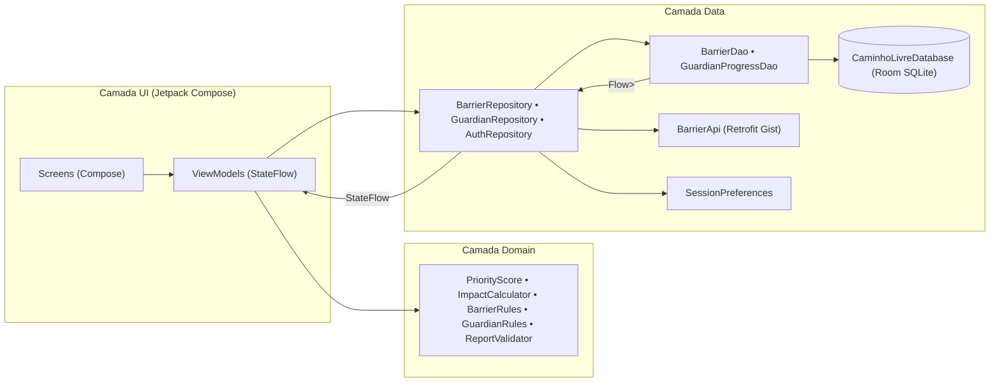
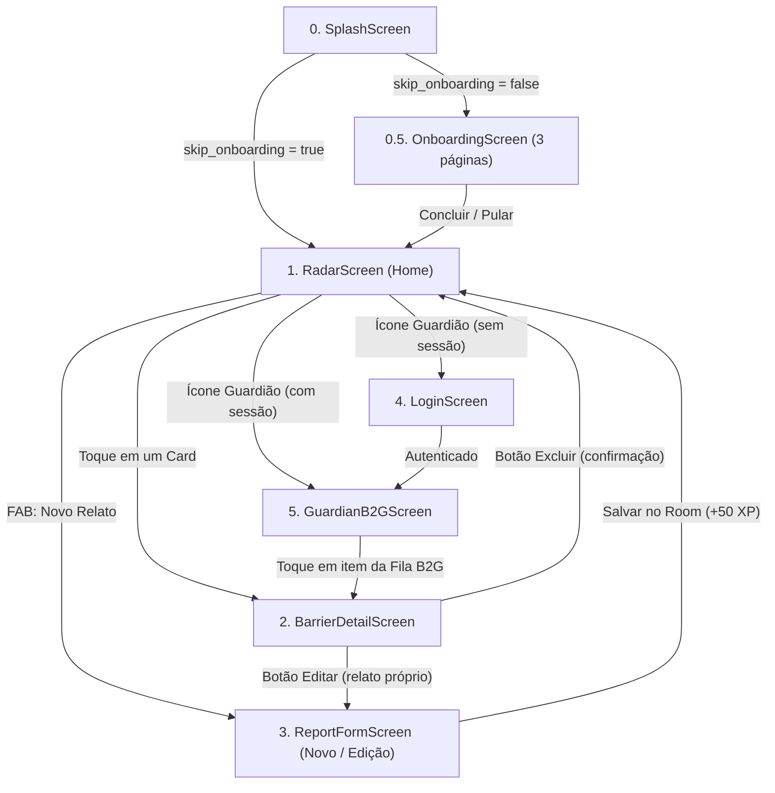
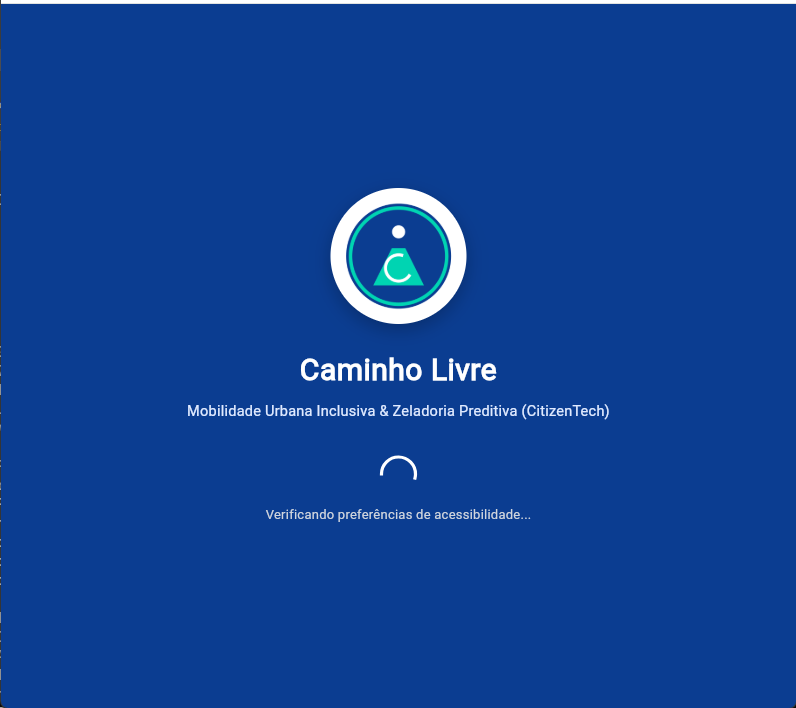
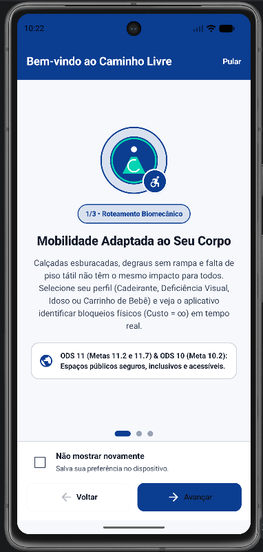
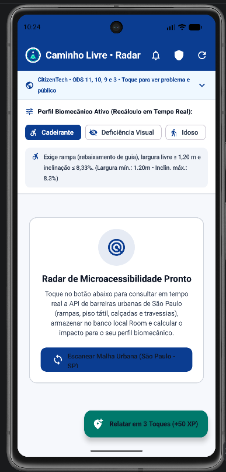
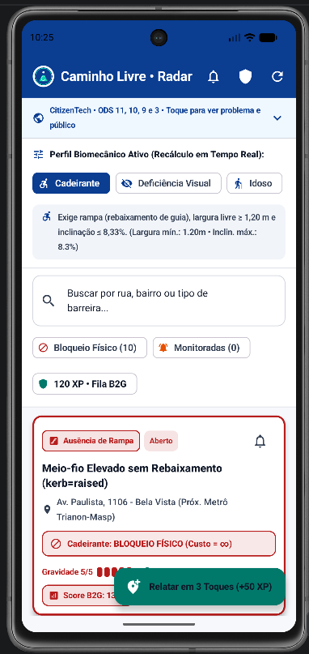
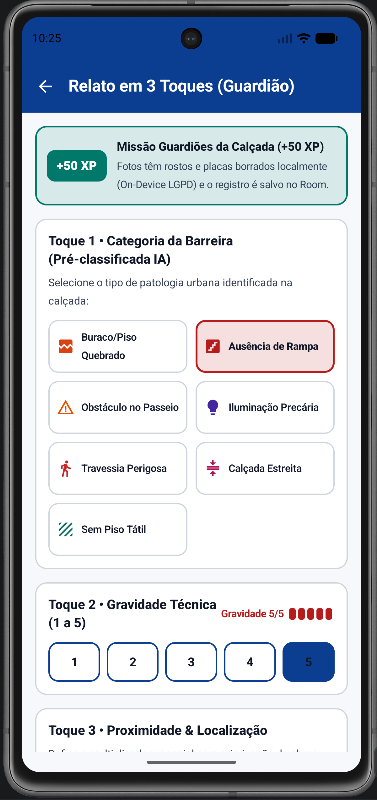
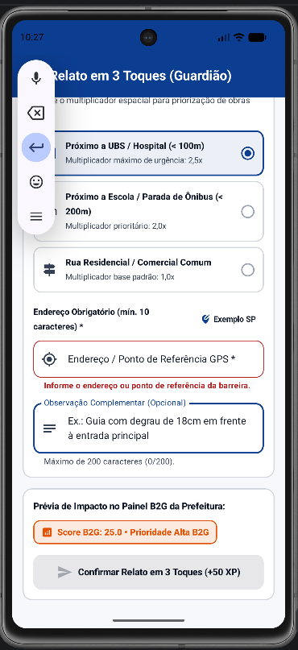
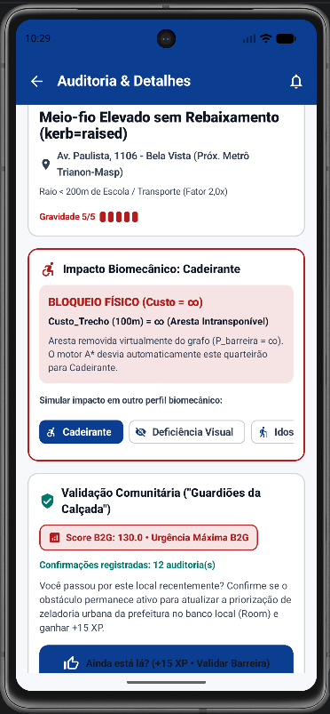
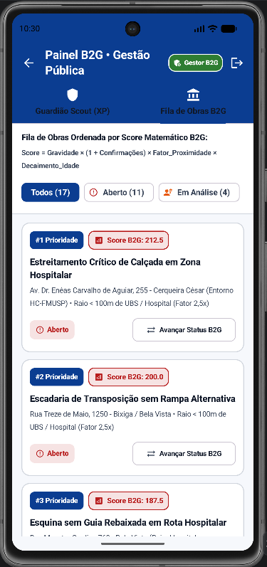

# Caminho Livre — Mobilidade Urbana Inclusiva & Zeladoria Preditiva (CitizenTech)

> **Global Solution 2026 (2º Semestre) — Android Kotlin Developer — FIAP**
> **Professor:** Ewerton Luiz de Lima Carreira

---

## 1. Integrantes da Equipe (Identificação Obrigatória)

| Nome Completo (Sem Abreviações) | RM |
| :--- | :--- |
| Gabriel José Lima da Silva | RM 556695 |
| Lucas Vendramini Lubianco | RM 556161 |
| Gabriel Doná Braga Araujo | RM 558142 |

---

## 2. Problema Real, Público Beneficiado e Proposta CitizenTech

### Problema Real Enfrentado
Nas cidades brasileiras, milhões de cidadãos com restrições de mobilidade descobrem que uma calçada é fisicamente intransponível apenas quando já estão retidos no percurso. Ausência de rampas (rebaixamento de guia), calçadas esburacadas ou estreitas ($\le 1,20\text{ m}$), falta de piso tátil e iluminação precária transformam deslocamentos básicos até **Unidades Básicas de Saúde (UBSs), hospitais, escolas e transporte público** em jornadas de alto risco físico. Ao mesmo tempo, as prefeituras carecem de dados estruturados e auditados pela comunidade para priorizar onde executar reparos primeiro.

### Público Beneficiado (Cidadãos e Gestores)
1. **Pessoas em Cadeira de Rodas (`Cadeirante`):** dependem de rebaixamento de guia, largura livre $\ge 1,20\text{ m}$ e inclinação $\le 8,33\%$ (ABNT NBR 9050).
2. **Pessoas com Deficiência Visual ou Baixa Visão (`Deficiência Visual`):** necessitam de piso tátil alerta/direcional contínuo e passeios livres de obstáculos.
3. **Pessoas Idosas (`Idoso`):** altamente vulneráveis a quedas graves causadas por desníveis, buracos e iluminação inoperante.
4. **Famílias com Carrinho de Bebê (`Carrinho de Bebê`):** exigem superfície contínua e travessias rebaixadas.
5. **Auditores Comunitários (`Guardião Scout`) e Gestores Públicos (`Gestor B2G`):** voluntários que mapeiam/validam obstáculos e engenheiros municipais que utilizam a fila matemática de priorização para alocar o orçamento de zeladoria urbana.

### Proposta de Solução (`Caminho Livre`)
O **Caminho Livre** é um aplicativo Android nativo desenvolvido em **Kotlin** e **Jetpack Compose** que conecta **mobilidade urbana inclusiva**, **crowdsourcing gamificado ("Guardiões da Calçada")** e **zeladoria pública preditiva (B2G)** com persistência local em **Room**:

1. **Radar Adaptativo por Perfil Biomecânico:** avalia cada barreira urbana segundo os parâmetros físicos tolerados por 5 perfis, sinalizando em tempo real onde há **Bloqueio Físico ($\text{Custo} = \infty$)** segundo a ABNT NBR 9050.
2. **Relato em 3 Toques + Validação Comunitária Persistida no Room:** cidadãos relatam novas barreiras com validação obrigatória de endereço (+50 XP), editam ou excluem seus próprios relatos, monitoram reparos favoritos e confirmam obstáculos existentes pelo botão **"Ainda está lá?"** (+15 XP).
3. **Painel do Gestor Público & Score B2G:** converte os relatos armazenados no Room em uma fila matemática de priorização de obras públicas, aplicando multiplicadores espaciais para obstáculos situados no entorno de UBSs, hospitais e escolas, permitindo avançar o status do ciclo de vida da obra (`Aberto` $\rightarrow$ `Em Análise` $\rightarrow$ `Resolvido`).

> **Nota de Escopo (Protótipo Acadêmico):** Este aplicativo é um protótipo acadêmico funcional para a Global Solution da FIAP. A sincronização inicial utiliza um dataset simulado hospedado em Gist (`barriers_sp.json`) com cache e persistência completa via **Room** no dispositivo; não há integração real com sistemas governamentais de prefeituras.

---

## 3. Alinhamento com os Objetivos de Desenvolvimento Sustentável (ODS da ONU)

| ODS da ONU | Metas Endereçadas | Justificativa e Conexão Direta com o Aplicativo |
| :--- | :--- | :--- |
| **ODS 11 — Cidades e Comunidades Sustentáveis** *(Principal)* | Metas **11.2** (sistemas de transporte seguros, acessíveis e sustentáveis) e **11.7** (acesso universal a espaços públicos seguros, inclusivos e acessíveis, especialmente para pessoas com deficiência e idosos) | O aplicativo mapeia barreiras de microacessibilidade em calçadas e travessias, parametrizando o impacto físico para cadeirantes, idosos, pessoas com deficiência visual e carrinhos de bebê. |
| **ODS 10 — Redução das Desigualdades** | Meta **10.2** (empoderar e promover a inclusão social, econômica e política de todos, independentemente de deficiência ou idade) | Elimina a assimetria informacional no deslocamento urbano, permitindo que pessoas com mobilidade reduzida identifiquem bloqueios físicos antes de ficarem retidas no percurso. |
| **ODS 9 — Indústria, Inovação e Infraestrutura** | Meta **9.1** (desenvolver infraestrutura de qualidade, confiável, sustentável e resiliente, com foco no acesso equitativo) | A equação de **Score B2G** orienta investimentos de infraestrutura municipal para gargalos críticos no entorno de UBSs, hospitais e escolas. |
| **ODS 3 — Saúde e Bem-Estar** | Meta **3.6** (reduzir acidentes de trânsito e lesões no deslocamento urbano) | Previne quedas severas em idosos e acidentes em travessias perigosas ao sinalizar crateras, falta de rampa e trechos sem iluminação. |

### Equações de Domínio Implementadas
- **Equação de Custo Dinâmico de Trecho por Perfil (`ImpactCalculator.kt`):**
  $$\text{Custo}(e, P) = L_e \cdot \left(W_{\text{base}} + \sum P_{\text{barreira}}(P)\right)$$
- **Equação de Score de Priorização B2G (`PriorityScore.kt`):**
  $$\text{Score}_{\text{B2G}} = \text{Gravidade} \times (1 + \text{Confirmações}) \times F_{\text{proximidade}} \times \text{Decaimento}_{\text{idade}}$$

---

## 4. Funcionalidades Implementadas e Mapeamento da Rubrica

| Critério da Rubrica | Pontos | Implementação no Projeto Kotlin |
| :--- | :---: | :--- |
| **1. Contextualização e tela inicial** | 1,0 | `SplashScreen`, `OnboardingScreen` (3 páginas explicando problema, público e ODS) e banner expansível no topo da `RadarScreen` apresentando objetivo, público beneficiado e ODS. |
| **2. Navegação entre telas** | 1,5 | `CaminhoLivreNavHost.kt` com **Navigation Compose** conectando 7 rotas (`splash`, `onboarding`, `radar`, `detail/{barrierId}`, `report?barrierId={barrierId}`, `login`, `guardian`) com passagem de argumentos tipados e retorno seguro na pilha. |
| **3. Interface e experiência de uso** | 1,5 | Componentes **Material 3** (`Scaffold`, `TopAppBar`, `LazyColumn`, `Card`, `OutlinedTextField`, `FilterChip`, `ExtendedFloatingActionButton`, `TabRow`, `AlertDialog`, `SnackbarHost`), estados Inicial, Carregando, Erro e **Estado Vazio por Filtro**. |
| **4. Dados, cadastro e interação funcional** | 2,0 | Entidade `BarrierEntity` (14 atributos); cadastro com **validação obrigatória de endereço (mín. 10 caracteres)** em `ReportValidator.kt`; ações adicionais: **Confirmar ("Ainda está lá?")**, **Monitorar/Favoritar**, **Avançar Status B2G**, **Editar** e **Excluir** relatos próprios. |
| **5. Persistência local com Room** | 1,5 | `CaminhoLivreDatabase` (`barriers` + `guardian_progress`), `BarrierDao` e `GuardianProgressDao`. Todos os relatos criados, edições, exclusões, favoritos, confirmações, status B2G e XP permanecem salvos ao fechar e reabrir o app. |
| **6. Organização do código e estado** | 1,5 | Separação em camadas `data` / `domain` / `ui`; **ViewModel + `StateFlow`** em todas as telas observando `Flow` do Room de forma reativa. |
| **7. Documentação e demonstração** | 1,0 | Este `README.md` completo + roteiro e evidências visuais em `docs/screenshots/`. |

---

## 5. Tecnologias Utilizadas

- **Linguagem:** Kotlin 2.2 (JVM Target 17)
- **Interface Declarativa:** Jetpack Compose + Material Design 3 (Alto Contraste WCAG)
- **Navegação:** AndroidX Navigation Compose (`2.9.0`)
- **Gerenciamento de Estado e Ciclo de Vida:** AndroidX Lifecycle ViewModel Compose + Coroutines / `StateFlow` (`2.9.4`)
- **Persistência Local (Obrigatória):** AndroidX Room Runtime, Room KTX e Room Compiler via KSP (`2.7.1`)
- **Consumo de API REST (Sincronização Inicial):** Retrofit 2 (`2.11.0`) + Gson Converter + OkHttp (`4.12.0`)
- **Carregamento de Imagens:** Coil Compose (`2.6.0`) com filtro de desfoque LGPD (`Modifier.blur`) e fallback offline
- **Testes Unitários:** JUnit 4 + Kotlinx Coroutines Test

---

## 6. Arquitetura e Fluxo de Navegação



### Fluxo de Telas (`CaminhoLivreNavHost`)



### Estrutura de Pastas do Código-Fonte

```text
app/src/main/java/br/com/fiap/citizentech/caminholivre/
├── CaminhoLivreApplication.kt        # Inicializa o AppContainer
├── MainActivity.kt                   # Activity Compose principal
├── di/
│   └── AppContainer.kt               # Injeção manual de dependências (Room, Retrofit, Repositórios)
├── data/
│   ├── local/                        # Persistência Room (BarrierEntity, GuardianProgressEntity, DAOs, Database)
│   ├── remote/                       # API REST Retrofit (BarrierApi, BarrierDto, RetrofitFactory)
│   ├── preferences/                  # Preferências de sessão (SessionPreferences)
│   └── repository/                   # BarrierRepository, GuardianRepository, AuthRepository
├── domain/
│   ├── model/                        # Enums e modelos (BarrierCategory, BarrierStatus, MobilityProfile, UserRole...)
│   └── rules/                        # Regras puras (PriorityScore, ImpactCalculator, BarrierRules, ReportValidator...)
└── ui/
    ├── theme/                        # Paleta de alto contraste, tipografia e CaminhoLivreTheme
    ├── navigation/                   # AppRoutes e CaminhoLivreNavHost
    ├── components/                   # BarrierCard, BarrierImage, ProfileSelectorBar, StateWidgets, etc.
    └── screens/                      # splash, onboarding, radar, detail, report, login, guardian
```

---

## 7. Perfis de Acesso e Credenciais de Teste (RBAC)

Na tela de Login há **botões de preenchimento rápido em 1 toque** (*"Preencher Cidadão Comum"* e *"Preencher Gestor Público B2G"*), além das credenciais abaixo:

| Perfil | Usuário / E-mail | Senha | Escopo de Visão |
| :--- | :--- | :--- | :--- |
| **1. Cidadão Comum (Scout)** | `cidadao@caminholivre.com.br` *(ou `cidadao`)* | `123456` | Acesso exclusivo ao painel **Guardião Scout** (XP persistido no Room, nível, contador de empatia e insígnias). |
| **2. Gestor Público (B2G)** | `gestor@sp.gov.br` *(ou `gestor`)* | `gestor123` *(ou `admin123`)* | Acesso completo às abas **Guardião Scout** e **Fila de Obras B2G** (ordenada por Score B2G, filtro por status e botão para avançar status da obra no Room). |

---

## 8. Instruções para Executar o Aplicativo no Android Studio

1. **Pré-requisitos:**
   - **Android Studio** (Ladybug / Meerkat / Panda ou superior) com **JDK 17+** configurado em *Settings $\rightarrow$ Build, Execution, Deployment $\rightarrow$ Build Tools $\rightarrow$ Gradle*.
   - **Android SDK** com `compileSdk 36` (API 36) e um Emulador Android (AVD) com **API 26 (Android 8.0)** ou superior.
2. **Importação do Projeto:**
   - Extraia o arquivo `.zip` da entrega (ou clone o repositório) e abra a pasta raiz `GS2_CITIZENTECH-Kotlin` no Android Studio.
   - Aguarde o **Gradle Sync** finalizar.
3. **Execução:**
   - Selecione um emulador Android ativo e clique em **Run 'app'** (`Shift + F10`).
4. **Execução via Linha de Comando (Opcional):**
   ```powershell
   .\gradlew.bat assembleDebug
   .\gradlew.bat testDebugUnitTest
   ```

---

## 9. Fluxo Principal e Evidências de Funcionamento (Capturas de Tela)


### 9.1. Contextualização, Onboarding e Radar Inicial
1. Ao abrir o aplicativo, a **SplashScreen** exibe a identidade visual e redireciona para o **Onboarding** de 3 páginas (com opção *"Não mostrar novamente"*).
2. No **Radar (Home)**, o botão **"Escanear Malha Urbana (São Paulo - SP)"** consulta o endpoint REST via Retrofit e armazena as barreiras no banco local **Room**.

| Splash Screen | Onboarding (ODS & Proposta) | Radar — Estado Inicial | Radar — Lista Sincronizada no Room |
| :---: | :---: | :---: | :---: |
|  |  |  |  |

### 9.2. Evidência de Cadastro com Validação e Criação de Registro (Critérios 4 e 7)
1. Toque no botão flutuante **"Relatar em 3 Toques (+50 XP)"**.
2. Com o campo de endereço vazio ou com menos de 10 caracteres, o formulário exibe a mensagem de erro vermelha e bloqueia o botão de envio (**validação de campo obrigatório**).
3. Ao informar um endereço válido e confirmar, o novo registro é salvo no **Room** (com selo **"Seu Relato"**), soma **+50 XP** e aparece imediatamente no topo da lista do Radar.

| Validação de Campo Obrigatório (Erro) | Formulário Preenchido (3 Toques) | Registro Criado no Radar (+50 XP) |
| :---: | :---: | :---: |
|  |  |  |

### 9.3. Evidência das Ações Adicionais e Persistência Após Reabrir o App (Critérios 4, 5 e 7)
1. Na tela **Auditoria & Detalhes**, o usuário pode:
   - Confirmar **"Ainda está lá? (+15 XP)"**, incrementando as confirmações e recalculando o Score B2G no Room;
   - Alternar o **Monitoramento (Favorito)**;
   - **Editar** ou **Excluir** um relato criado pelo próprio usuário.
2. No **Painel B2G (Gestor Público)**, o gestor avança o status da obra (`Aberto` $\rightarrow$ `Em Análise` $\rightarrow$ `Resolvido`).
3. **Evidência de Persistência (Room):** mesmo após **fechar completamente o aplicativo (remover dos recentes) e abri-lo novamente**, o relato cadastrado, as confirmações, o status B2G, os favoritos e o XP acumulado permanecem intactos na interface.

| Detalhes, Validação "Ainda está lá?" e Edição/Exclusão | Login e Painel Gestor B2G (Avançar Status) | Evidência Após Fechar e Reabrir o App (Persistência Room) |
| :---: | :---: | :---: |
|  |  |  |

